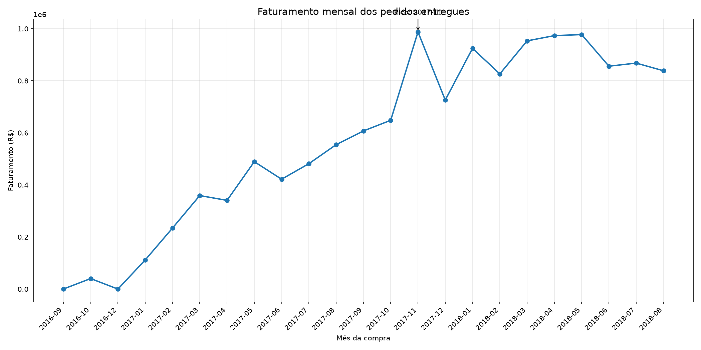
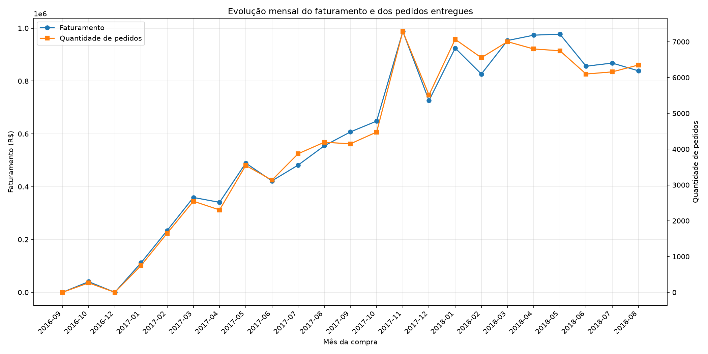
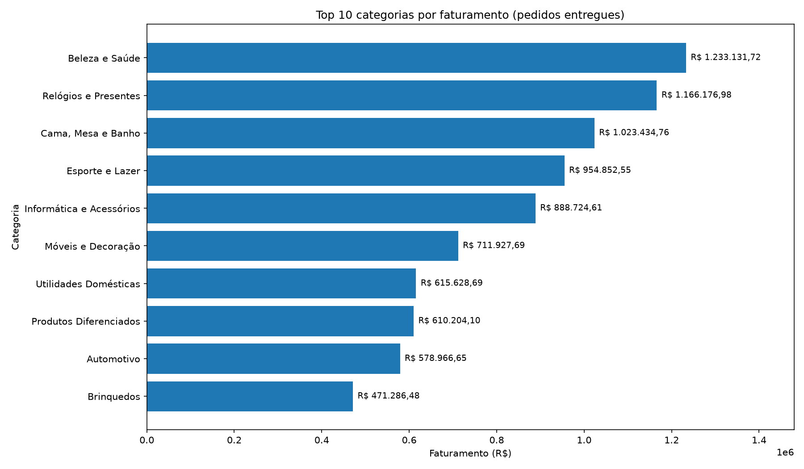
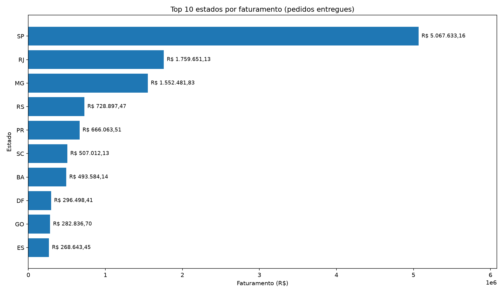

# 📊 Análise de Vendas e Entregas — E-commerce Olist

Análise exploratória em Python de **99 mil pedidos** de um e-commerce brasileiro (Olist), com foco em faturamento, produtos, categorias, estados e prazo de entrega.

Projeto de portfólio feito para praticar o ciclo completo de análise: carregar, limpar, cruzar tabelas, calcular indicadores e visualizar os resultados.

## 🔎 Principais resultados

- **Novembro de 2017** teve o maior faturamento mensal da série: **R$ 987.765,37**, com **7.289 pedidos entregues**.
- **Beleza e Saúde** (`beleza_saude`) teve o maior faturamento entre as categorias: **R$ 1.233.131,72**.
- **Cama, Mesa e Banho** (`cama_mesa_banho`) foi a categoria com mais unidades vendidas: **10.953 itens**.
- **91,89% das entregas** chegaram no prazo ou antes.
- **8,11% das entregas** chegaram atrasadas.

> **Critérios da análise:** o faturamento considera apenas pedidos entregues e utiliza o valor dos produtos (`price`), sem incluir o frete. Os indicadores de prazo consideram 96.470 pedidos com datas válidas de entrega e previsão.

> Os valores consideram apenas pedidos com status `delivered` e o preço dos itens (sem frete).

## 📈 Gráficos

| Faturamento mensal | Faturamento x pedidos |
|---|---|
|  |  |

| Top 10 categorias por faturamento | Top 10 estados por faturamento |
|---|---|
|  |  |

Todos os gráficos ficam na pasta [`imagens/`](imagens/).

## 🎯 O que o projeto responde

1. Quantos pedidos foram entregues e quantos chegaram **no prazo** ou **atrasados**?
2. Como o faturamento e o número de pedidos evoluem **mês a mês**?
3. Quais são os **produtos** mais vendidos e os que mais faturam?
4. Quais **categorias** lideram em faturamento, quantidade e preço médio?
5. Quais **estados** concentram clientes e faturamento?

## 📐 Definições e cuidados

* **Faturamento** = soma do preço dos itens (`price`), **sem o frete**.
* Só entram os pedidos com status `delivered`; o mês é o da **compra**, não o da entrega.
* O começo (2016) e o fim da série têm poucos pedidos, então esses meses não devem ser usados para falar de tendência.
* As junções entre tabelas usam `validate="many_to_one"`, para o pandas avisar caso alguma junção duplique linhas e distorça os totais.

## 🛠️ Tecnologias

* **Python 3** · **Pandas** (tratamento e análise) · **Matplotlib** (gráficos) · **VS Code**

## 📁 Estrutura

```text
projeto-analise-dados_olist/
├── dados/                 # CSVs do Kaggle (não versionados)
├── imagens/               # gráficos gerados pelo script
├── analise_vendas.py      # código da análise
├── requirements.txt
└── README.md
```

## ▶️ Como executar

1. Baixe os dados no Kaggle: [Brazilian E-Commerce Public Dataset by Olist](https://www.kaggle.com/datasets/olistbr/brazilian-ecommerce) (licença CC BY-NC-SA 4.0).
2. Coloque na pasta `dados/` estes arquivos:
   `olist_orders_dataset.csv`, `olist_order_items_dataset.csv`, `olist_products_dataset.csv` e `olist_customers_dataset.csv`.
3. No terminal:

```bash
pip install -r requirements.txt
python analise_vendas.py            # salva os gráficos em imagens/
python analise_vendas.py --mostrar  # também abre as janelas dos gráficos
```

## 💡 Aprendizados

* Cruzar várias tabelas (`merge`) e conferir se a junção não duplica linhas.
* Agrupar e resumir com `groupby`, `agg` e `nlargest`.
* Transformar o código repetido em **funções reutilizáveis** (um único código gera todos os gráficos de barras).
* Separar a definição do indicador (o que é "faturamento") da análise, para os números serem consistentes em todo o projeto.

## 🚀 Próximos passos

* Refazer as consultas principais em **SQL**.
* Criar um dashboard interativo em **Power BI** com os mesmos indicadores.
